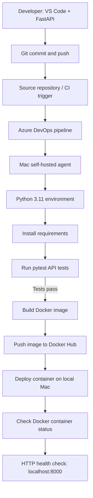

# Python FastAPI DevOps Project

A hands-on DevOps learning project demonstrating how a Python REST API moves from local development through automated testing, Docker image creation, image publishing, and deployment to a local Mac using an Azure DevOps self-hosted agent.

> **Project status:** Completed as a learning exercise. The Azure DevOps pipeline is disabled, the self-hosted agent is stopped, and local project containers have been removed to avoid leaving services running.

## Architecture and CI/CD workflow



**Note:** The repository was also backed up to GitHub. The diagram illustrates the pipeline workflow; the exact CI trigger and source repository depend on the Azure DevOps pipeline configuration.

## What I built

- **REST API:** A simple FastAPI application in `main.py` with `GET /` (welcome message) and `GET /products` (sample products).
- **Automated tests:** Pytest tests in `test_main.py` check both endpoints. The local test run passed **2 tests**.
- **Dependency management:** `requirements.txt` captures Python dependencies. Python **3.11** was installed for the Mac-based pipeline setup.
- **Containerization:** A Dockerfile packages the API so it can run as a container.
- **Continuous integration:** Azure DevOps YAML installs dependencies, runs tests, and builds and pushes a Docker image to Docker Hub.
- **Continuous deployment:** A second Azure DevOps job uses a Mac self-hosted agent and `deploy.sh` to deploy a container, inspect its status, and test `http://localhost:8000/`.
- **Version control:** Git tracks code changes, and the finished project is stored on GitHub.

## Technologies and why I used them

| Tool | Purpose |
| --- | --- |
| Python + FastAPI | Build a small HTTP API |
| Pytest | Verify endpoints automatically |
| Git + GitHub | Track changes and preserve project source |
| Azure DevOps Pipelines | Automate build, test, image publishing, and deployment |
| YAML | Define the CI/CD pipeline as code |
| Docker | Package and run the application consistently |
| Docker Hub | Store the built Docker image |
| Mac self-hosted agent | Run pipeline jobs on the local machine |
| Shell scripting | Automate deployment and verification commands |
| Ansible | Additional local automation practice; not shown as a required CI/CD stage |
| SonarQube | Additional code-quality tooling explored locally; not confirmed as a pipeline gate |

## Local development

Run these commands from the repository directory:

```bash
python3.11 -m venv .venv
source .venv/bin/activate
python -m pip install -r requirements.txt
python -m pytest -v
uvicorn main:app --reload
```

Then visit:

- `http://127.0.0.1:8000/` — welcome response
- `http://127.0.0.1:8000/products` — sample product list
- `http://127.0.0.1:8000/docs` — interactive FastAPI API documentation

## How the pipeline works

1. Code changes are committed and pushed to source control.
2. Azure DevOps starts the configured pipeline.
3. The build job verifies Python, creates an isolated environment, and installs dependencies.
4. Pytest checks the API before packaging.
5. Docker builds an image and pushes it to Docker Hub using a configured service connection.
6. The deployment job runs on a Mac self-hosted agent and executes `deploy.sh`.
7. The pipeline verifies that the container is running and that the API responds over HTTP.

**Observed result:** The final Azure DevOps run shown in the project screenshots completed successfully for both **Build, Test and Push Docker Image** and **Deploy Docker Container on Mac**. An earlier local Pytest run reported **2 passed** and **1 deprecation warning**.

## Additional learning: Ansible and SonarQube

I also explored local containers related to **Ansible** and **SonarQube**. These tools are useful for infrastructure/configuration automation and code-quality analysis, respectively. They are documented as supporting learning exercises, not as fully integrated stages of the successful Azure DevOps workflow.

## Safe shutdown and cost awareness

After completing the exercise:

- Pushed the project to GitHub for future reference.
- Disabled the Azure DevOps pipeline.
- Stopped the self-hosted Azure DevOps agent.
- Stopped and removed the local project containers, including FastAPI test/deployment containers and SonarQube; `docker ps -a` showed no remaining containers.
- Checked Azure DevOps organization billing, which showed no paid parallel jobs configured.
- Checked the Azure subscription overview, which displayed a current cost of $0.00 and no active resource usage at that time.

**Important:** These checks describe the observed state, not a guarantee against future charges. Cloud billing, service connections, credentials/tokens, and any other subscriptions should be reviewed independently. Stopping containers does not revoke API tokens.

## Key DevOps concepts learned

**CI (Continuous Integration)** automatically checks new code through installation, testing, and image building. **CD (Continuous Deployment/Delivery)** automates the next steps needed to run the tested application. **Containers** make packaging repeatable; **self-hosted agents** execute automation on machines you control; and **Git** preserves the history of changes.

## Repository

[GitHub: python-devops-project](https://github.com/jamiharshath-cyber/python-devops-project)
